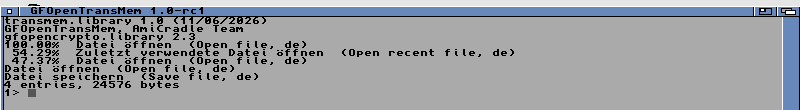

# GFOpenTransMem

`transmem.library`: a translation memory for AmigaOS 3.x on SQLite. It
keeps pairs of source text and translation and finds the best matches
for new text the way Poedit's translation memory does: the same three
searches, the same scores, the same merging of hits and the same entry
ids. Made for the Poedit port (DalsinAI/gfamigapoedit), for any program
that wants one.

- `transmem.library` for LIBS:, with SQLite 3.53.4 (gfopensqlite's
  version) inside, its files on dos.library.
- `libtransmem.a`, the link stub (opens `TransMemBase`), and the
  headers: `<proto/transmem.h>`.
- `TransMem`, the command: look up, add, export, import, clear.
- `Install-GFOpenTransMem`, the Amiga Installer script.

The calls are in [docs/transmem.library.md](docs/transmem.library.md).

## Building

```
./build-amiga.sh
```

needs the os32-gcc16 stove (or `PREFIX=` a GFOpenAmigaGCC release with
`NDK_INC=` OpenNDK's Include_H). The SQLite amalgamation is fetched from
sqlite.org and its SHA-256 checked (`SOURCES`). Output in `build-amiga/`.
The build fails if the library calls a floating point routine fpuauto
does not take to the FPU, or needs anything outside itself.

## Tested

On a 68040 AmiCradle lab (OS 3.2.3), 1.0-rc1 from the release package:



## Licence

MIT, Copyright (c) 2026 AmiCradle Team: see [LICENSE](LICENSE). SQLite is
public domain and is not in this repository; see
[THIRD_PARTY_NOTICES.md](THIRD_PARTY_NOTICES.md).

Designed, tested and delivered by The AmigaChrome Team.
